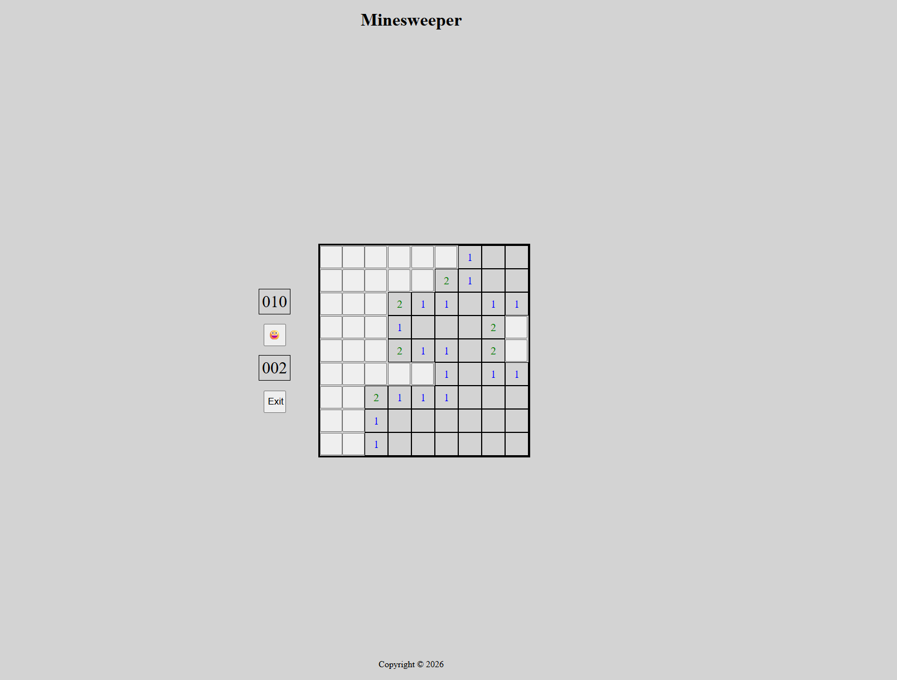

# Minesweeper (PG30_ParthoGhosh)

This repository holds source code of my html final assignment 3.

PLEASE ENSURE YOU ARE SWITCHED TO `assignment3` BRANCH IN GIT.

## How to run
Assuming `node-js` and `git` is installed.

Steps to run this project as follows:
* Clone this repository.
* Run `git checkout assignment3`
* Ensure http-server is installed. If not then run `npm install --global http-server`. For more details, go to this [link](https://github.com/http-party/http-server#readme).
* Change directory into the project from command prompt. Run `npx http-server -c-1`
* Go to browser and navigate to http://localhost:8000.

